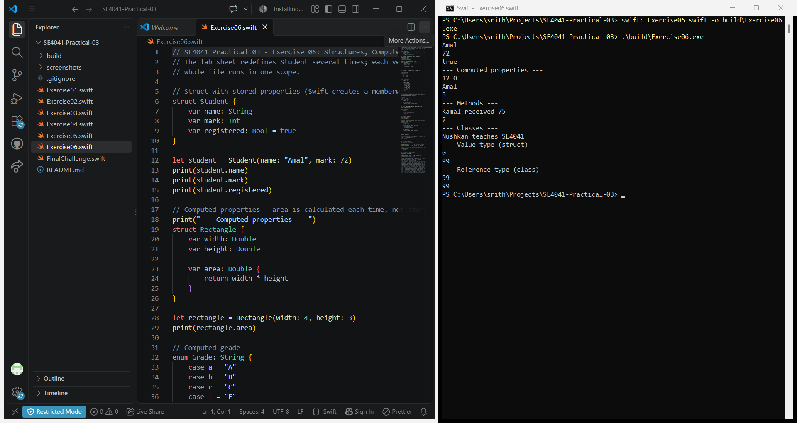
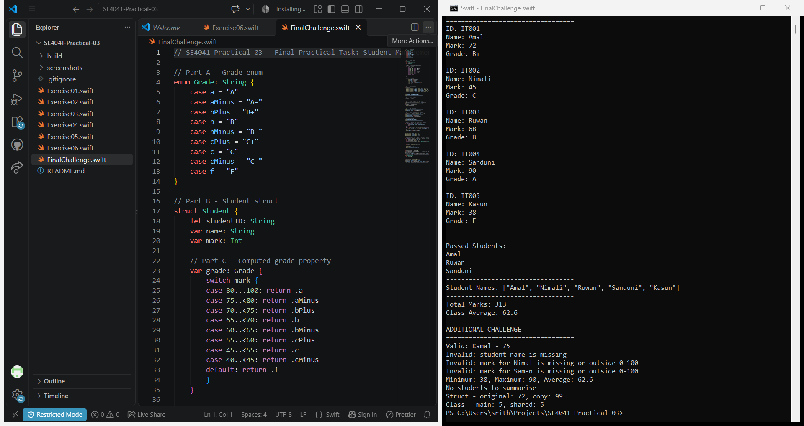

# SE4041 – Practical 03: Functions, Enums, Structs & Classes in Swift

Functions, `guard`, tuples, closures (`map`, `filter`, `reduce`), enums, structs and classes – ending with a Student Management System program.

**Name:** Abisheak S  
**Student ID:** IT21244384

## Screenshots

